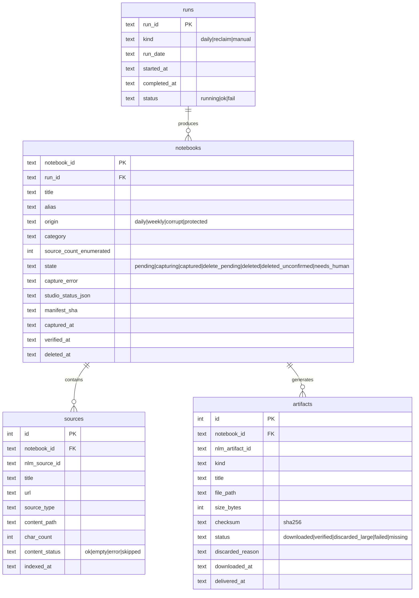

# ✨ Capture-then-delete NotebookLM lifecycle with a local SQLite archive

## Overview

The NotebookLM account sits at **499 / 500 notebooks** — the Plus cap. `nlm notebook create` has nowhere to go, so both pipelines have been dead since roughly **2026-08-16**. Nothing in the repo has ever deleted a notebook.

This change stops treating NotebookLM as storage. A run creates a notebook, generates artifacts, captures everything to disk + SQLite, **proves** the capture is real, and only then deletes the notebook. Account footprint stays flat forever. A one-off reclaim applies the same capture-then-delete to 465 existing pipeline notebooks, recovering ~3 months of artifacts that were generated and never downloaded.

Two decisions made during planning reshape the scope from the brainstorm:

- **Weekly notebook creation is retired.** It is the source of the explosion — `Machine Learning - Week of 2026-08-15` alone was **28 notebooks / 441 sources**. Weekly's *data* steps (X monitoring, news archiving, HF triage, content-processing) fold into the daily run; only its notebook and artifact steps go. Daily becomes the single notebook-producing pipeline, at ~1 notebook/day, and gets the full studio set.
- **Sources older than 2 days are dropped.** Daily already uses a 2-day window capped at 15 URLs. With weekly gone, the 899 unprocessed sources (556 `processing`, 343 `queued`) would strand forever, so a retention step ages them out explicitly rather than leaving them to rot.

Because weekly notebooks are gone, the brainstorm's "fix weekly split sizing" decision is **superseded** — there is nothing left to split.

## Problem Statement

| Fact | Evidence |
|---|---|
| Account at the cap | `nlm notebook list --json` → 499 |
| No deletion exists anywhere | Exhaustive grep: zero `notebook delete`, zero TTL, zero cap monitoring |
| Weekly is the amplifier | 399 of 465 deletable notebooks are weekly; one category-week produced 28 |
| Registry tracks 16% | 75 rows in `data/notebooks.json` vs 474 live pipeline notebooks. Cause: `daily_pipeline.sh:740` registers at the *last* step, so any earlier failure orphans the notebook |
| Artifacts generated, never downloaded | `Daily Feed — 2026-08-16` still holds a **43-minute, 83 MB** podcast |
| Backlog is stranded | 899 sources in non-terminal states, nearly all outside daily's 2-day window |

### Notebook disposition (live, 2026-09-29) — totals 499

| Class | Count | Disposition |
|---|---|---|
| `Daily Feed — YYYY-MM-DD` | 63 | capture + delete |
| `<Group> - Week of YYYY-MM-DD` | 399 | capture + delete |
| Corrupted daily titles (`Daily Feed \t6-02-20`, `Daily Feed \x02026-02-20`) | 3 | capture + delete, **by explicit id** |
| **Deletable total** | **465** | |
| Personal / hand-made | 24 | **protected** |
| `Research Digest - <date>` | 9 | **protected** (see below) |
| Empty title, 0 sources | 1 | **protected**, routed to `needs_human` |
| **Excluded total** | **34** | |

### Correction: the 9 `Research Digest` notebooks

The brainstorm attributed these to a "legacy orchestrator" in this repo. **That attribution was wrong.** No code in this repo emits `Research Digest - <date>` as a notebook title — `src/pipeline/content_processor.py:63` emits `# {group} Research Digest — {date}` with an em dash, as a *companion-note heading*, not a title. Their dates (`2023-10-03` ×3, `2024-06-02/10/26/27`) predate this repo's first commit (**2026-03-14**, `af9cec0`) by 1.5–2.5 years. They were created by something outside this repo. They are now **protected**, reversing the brainstorm's "include them too" decision, which was made on the bad attribution.

## Verified Findings (empirical, this session)

Tested against the live CLI and repo, not inferred. Several contradict current documentation.

| Claim | Result |
|---|---|
| **BUG-001 (`nlm download audio` TooManyRedirects) is FIXED** | `nlm download all` pulled an 83 MB `.m4a`; `ffprobe` confirms 2582 s @ 257 kbps. **The CDP and Playwright audio workarounds are obsolete.** `docs/BUGS.md:12-27` and CLAUDE.md are stale. |
| **`download all` names its output dir after the notebook TITLE** | Observed: `dl/Open Source & Tools (Part 12_21) - Week of 2026-08-15/`. With 4 duplicate titles across 9 notebooks this is a data-loss vector — see Risk R1. |
| `nlm download all --json` | Returns `{artifact_id, artifact_type, title, path, success, error}` per item — the `artifacts` row shape. |
| `nlm source content <id> --json` | `{"content": "..."}`. Works for `web_page` and `generated_text`. Carries nav boilerplate; a GitHub source begins `"Skip to content\n\nNavigation Menu\n\nSign in…"`. |
| `nlm notebook list --json` fields | Only `{id, title, source_count, updated_at}` — **no `created_at`**, no artifact info. Ordering "oldest first" must use `updated_at`, which is bumped by merely opening a notebook. Determining what to capture needs a per-notebook `studio status` call: **465 extra round-trips**. |
| `nlm note list` / `chats list` | **Empty** for pipeline notebooks. Capture is near-free and low-value. |
| `nlm delete notebook --confirm --json` | Exists (verified via `--help` only — **not executed**). |
| Installed `nlm` | **0.9.6** (CLAUDE.md says 0.3.15). |
| `MIN_NOTEBOOK_SCORE` | **0.3** at `src/rag/query.py:36` — CLAUDE.md documents 0.6. |
| Stale-lock timeouts are asymmetric | `daily_pipeline.sh:122` = 14400 s (4 h); `weekly_pipeline.sh:78` = 7200 s (2 h). A long reclaim can have its lock force-removed by the other pipeline. |
| 26 aliases contain a literal `/` | e.g. `general-(part-1/6)-2026-03-30`. `weekly_pipeline.sh:459-461` builds paths from these — writes into nonexistent directories. |
| Dead branch in triage | `src/data_triage.py:369` — `end - start` ≤ `IDEAL_SPLIT_SIZE` (15) < `MAX_SOURCES_PER_NOTEBOOK` (50), so the guard never fires. The hard cap is not enforced on the split path at all. |
| ChromaDB state | One collection `notebook_sources`, **404 rows / 56 notebook ids** (380 `source`, 24 `report_summary`, 0 `companion_note`). `research_reports` was never created. Local RAG today covers 56 of 474 pipeline notebooks. |
| Disk | 807 GiB free on `/Volumes/ext`; `data/` is 1.9 GB. Not a constraint. |

## Proposed Solution

```
daily run
  ├─ data steps (folded in from weekly): newsletter, blog, x-monitor,
  │                                      archive_old_news, hf_triage, content_processor
  ├─ expire sources older than 2 days
  ├─ create notebook  →  add sources  →  generate FULL studio set
  ├─ capture:  download all --json  +  source list  +  source content
  ├─ record:   SQLite rows, sha256 per artifact
  ├─ index:    ChromaDB `archive_sources` (purge this notebook's stale rows first)
  ├─ deliver:  Telegram (compress oversized first)
  ├─ VERIFY ◄─ the gate
  └─ delete:   nlm delete notebook + nlm delete alias
```

Failure anywhere before the gate leaves the notebook **alive** with `capture_status='failed'`. Deletion is never speculative.

### New modules

| File | Responsibility |
|---|---|
| `src/lib/archive_db.py` | Schema, migrations, WAL connection, typed accessors. |
| `src/lib/notebook_patterns.py` | `classify_title()` — used **only** to generate the allowlist once, never at delete time. |
| `src/nlm/notebook_capture.py` | `capture()`, `verify()`, `delete_if_verified()`. |
| `src/pipeline/reclaim_notebooks.py` | Backfill CLI. Resumable, per-notebook locked, auth-aware. |
| `src/pipeline/expire_sources.py` | Age out sources outside the 2-day window. |
| `src/rag/archive_index.py` | Index captured text into `archive_sources`. |
| `data/backfill-allowlist.json` | **Frozen** id→{title, source_count, updated_at}. The sole delete authority. |
| `data/backfill-excluded.json` | The 34 excluded ids with a reason each. |

### Modified

| File | Change |
|---|---|
| `src/pipeline/rag_chat.py:74-91` | **Delete** `query_notebook()` — not conditionalize it. Replace with local retrieve + GPT-4o synthesis. |
| `src/rag/query.py` | `--mode archive`; exclude rows lacking `has_local_text`; re-calibrate `MIN_NOTEBOOK_SCORE`. |
| `src/pipeline/fetch_latest.py` | **Remove** `load_notebooks_from_nlm` (:36-63) — it resurrects dead ids. Fix `DATA_DIR` (:22 → `src/data`, doesn't exist). |
| `scripts/fetch_and_deliver.sh:153-210` | Serve from DB. Zero `nlm download` calls remain. Remove `share public` (:210). |
| `scripts/daily_pipeline.sh` | Absorb weekly's data steps; add expiry; full studio set; new **Step 11** capture+verify+delete; remove Step 7 share link; collapse the 3-tier audio fallback (:534-553) to `download all`; register the notebook **early**, not at Step 10. |
| `scripts/weekly_pipeline.sh` | Remove Steps 5, 5.5, 6, 7 (notebook creation, artifacts, news digest, delivery). Retire the launchd agent. |
| `docs/BUGS.md` | BUG-001 → **fixed upstream in 0.9.6** with evidence. New entries for the alias-`/` bug and the dead triage branch. |
| `CLAUDE.md` | nlm version, new DB + data files, new scripts, revised pipeline tables, weekly retirement. |

### Archive layout

Keyed by `notebook_id` — **never** by title or alias. Titles contain `/`, tabs, `\x02`, em dashes, and duplicates; 26 aliases contain `/`.

```
data/archive/<notebook_id>/
  manifest.json          # what we believed we captured
  studio-status.json     # raw `nlm studio status` at capture time (audit trail)
  artifacts/…            # -d points HERE, so nlm's title-named subdir nests safely inside
  sources/<nlm_source_id>.txt
```

### Schema



`PRAGMA journal_mode=WAL`, `PRAGMA busy_timeout=30000`. `UNIQUE(notebook_id, nlm_artifact_id)` and `UNIQUE(notebook_id, nlm_source_id)` make re-capture idempotent.

### The delete state machine

Crash-safe by construction. Each transition is committed and fsynced **before** the side effect it authorizes.

| State on resume | Notebook live? | Action |
|---|---|---|
| `capturing` | either | discard partial files, restart this notebook |
| `captured` | yes | re-verify, then delete |
| `captured` | no | someone else deleted it → `deleted_unconfirmed`, alert |
| `delete_pending` | yes | retry delete |
| `delete_pending` | no | → `deleted` |
| `needs_human` | — | never touched automatically |

The id is appended to `data/archive/deleted-ids.log` (append-only, fsynced) *before* the delete call, so the record survives even a commit failure.

### The verification gate

Deletion is irreversible with no undo, so the gate demands **positive proof**, not absence of error. All must hold immediately before delete:

1. `notebook_id` is present in the frozen `data/backfill-allowlist.json`. **Titles are never re-matched at delete time** — a future personal notebook named `Anything - Week of 2026-03-01` must not become deletable.
2. `source_count` from enumeration == `len(nlm source list)` == count of DB source rows, and **> 0**. A vacuous `0 == 0` must not pass: a transient empty `source list` on auth flake would otherwise delete a 16-source notebook having captured nothing.
3. Every source row's `char_count` clears a per-`source_type` floor (`generated_text` ≥ 20, `web_page` ≥ 500) — a 403 page or cookie wall must not read as success.
4. Every `completed` artifact in `studio status` has a DB row whose file exists, is non-zero, passes a type check, and whose **sha256 recomputes to the stored value**.
   - markdown: does not begin `<!DOCTYPE html` / `<html`; audio & video: `ffprobe` duration > 0; PDF: begins `%PDF-`.
5. **No artifact is in a non-terminal state.** A Step 6.6b per-paper podcast that hit its 1200 s deadline is still generating server-side; capturing now and deleting would destroy it.
6. Every verified path resolves **inside** `data/archive/<notebook_id>/`, and `items[].path` came from the `--json` payload, never constructed.
7. `os.stat(base).st_dev` equals the device id recorded at process start **and** a volume sentinel file is readable. If `/Volumes/ext` unmounts mid-run, writes land on the boot disk's empty mountpoint: files exist, sizes are non-zero, sha256 verifies, the gate passes completely, and the data vanishes on remount.
8. The transaction is committed, fsynced, and WAL-checkpointed.

Any failure → `needs_human`. Never delete.

## Implementation Phases

> **Resequenced after review (2026-09-29).** Three verified findings removed the justification for doing the local-RAG rewrite first: `/chat` is already broken (`src/pipeline/rag_chat.py:27` points at a nonexistent `rag/query.py`), only **56** of the 465 deletable notebooks have ChromaDB routing rows, and `backup.sh` exits 1. Deletion cannot regress `/chat`, so the unblock goes first. Findings are tracked as `todos/031-046`.

### Phase A — Make deletion safe (no deletes yet)

Blocking P1s, all of which gate an irreversible operation:

- `034` Fix `backup.sh:107`; cover `research.db`, `data/archive/`, allowlist/excluded, `deleted-ids.log`; consistent SQLite backup; destination **off** `/Volumes/ext`; restore drill asserting counts.
- `037` Replace the `mkdir` lock with `flock(2)` in both pipelines; delete the unconditional `trap 'rmdir'` that lets a process destroy the new holder's lock.
- `032` Two parameterized delete authorities: `ReclaimAuthority` (frozen file) and `DailyAuthority` (this run's `run_id` + `origin='daily'` + `captured` in-process). Neither may fall back to the other.
- `033` Allowlist integrity: committed set-digest outside `data/`, UUID-regex per id, `allowlist ∩ excluded == ∅`, `|allowlist ∪ excluded| == 499`, live-drift halt, `MAX_DELETES_PER_RUN`, `--execute` requires a matching pre-approved manifest.
- `038` Schema hardening: `CHECK` on all six enum columns, `PRAGMA foreign_keys=ON`, `nlm_artifact_id NOT NULL` + surrogate, terminal `protected` state, `verified_at` cleared on re-capture, `user_version` + migration 001, `BEGIN IMMEDIATE`, no transaction across I/O.
- `039` `safe_archive_path()` applied at **write** and verify; reject absolute/`..`/symlink components; `st_ino` uniqueness; raw UUID to delete, never an alias.
- `035` `036` Gate: require `all(items[].success is True)`; terminal-status **allowlist** `{completed, failed}`; inspect `skipped[]`; `total_artifacts` cross-check; `studio status` must have succeeded; compare live `title`/`source_count`/`updated_at` against the frozen values.
- `043` Capture into `.staging-<run_id>/`, atomic rename after commit — never mutate a good capture in place.

**Gate:** allowlist frozen at 465/34 with a committed digest; a restore drill passes from off-volume storage; every gate-rejection path has a test.

### Phase B — Reclaim ← *unblocks production*

- `--no-delete` pass across the allowlist; audit the DB and the `needs_human` queue.
- Then `--execute --limit 5` on notebooks already mirrored in `data/daily-feed/`, manually audited.
- Then oldest-first in capped batches, **starting with the 409 that have no ChromaDB routing rows** — deleting those costs `/chat` nothing even once it is repaired. Re-verify that set immediately before the first batch.
- Auth re-checked proactively on a ≤8-minute cadence.

**Gate:** account below 400; all 34 excluded notebooks present; `nlm notebook create` works again.

### Phase C — Daily capture-then-delete

- Register the notebook early, not at Step 10 (`daily_pipeline.sh:740` is the documented cause of the 16% registry coverage).
- New final step: capture → verify → deliver → delete, using `DailyAuthority`.
- `046` Idempotency moved to the DB; condition-5 timeout behaviour specified; no notebook-creating path outside `daily_pipeline.sh`.
- Capacity guard: alert at 400, hard-fail create at 490.
- `041` `--form-string` in `telegram_send.sh` before anything routes generated text to Telegram.
- Full studio set on the daily notebook; oversized artifacts delivered then discarded locally.
- `042` `launchctl unload` the weekly agent — immediate cap relief, no fold-in required.

**Gate:** one full daily run leaves zero net notebooks and a complete DB row set.

### Phase D — Deferred, each its own plan

`/chat` repair + local RAG (`031`, `040`, `045`), `/generate` served from the DB, the weekly→daily fold-in (`042`), source expiry, `MIN_NOTEBOOK_SCORE` recalibration, doc corrections.

## System-Wide Impact

### Interaction graph

Daily Step 11 → `capture()` → `studio status` → `download all` → `source list` → `source content` ×N → SQLite txn → `archive_index` → ChromaDB write → `verify()` → `deleted-ids.log` → `nlm delete notebook` → `nlm delete alias` → commit `deleted_at`.

### Error & failure propagation

- Any exception before the gate → `needs_human` or `failed`; notebook survives; step reports non-fatal; next run retries.
- Auth expiry mid-capture → pause, `nlm_ensure_auth.sh`, resume **the same notebook**, one retry, then fail.
- SQLite contention → `busy_timeout` absorbs it; beyond that, fail the notebook rather than delete it.

### State lifecycle risks

Covered by the state machine and the append-only `deleted-ids.log`. The specific hazard — delete succeeds, commit fails — leaves `delete_pending` plus a log line; resume sees the notebook gone and closes it out as `deleted`.

### API surface parity

Three read surfaces must stop needing live notebooks, or Phase 3 breaks them: `src/pipeline/rag_chat.py` (`/chat`), `skills/chat-rag/SKILL.md` (LLM path), `scripts/fetch_and_deliver.sh` (`/generate`). Missing any one leaves a live dependency.

### Integration test scenarios

1. Capture → delete → `/chat` a question answerable only from that notebook's text → correct, cited answer.
2. Break NLM auth → `/generate report` → served from disk.
3. SIGKILL at each of the 5 states → resume reaches a correct terminal state, zero loss, zero duplicate downloads.
4. Reclaim + `daily_pipeline.sh --skip-nlm` concurrently → both complete, no `database is locked`, no interleaved ChromaDB writes.
5. Two notebooks with byte-identical titles → disjoint capture dirs, both non-zero `downloaded`.
6. Simulated `st_dev` change → no delete.

## Acceptance Criteria

### Classification
- [x] `data/backfill-allowlist.json` is frozen, count-asserted at load, and is the **sole** delete authority; title matching never runs at delete time.
- [x] `backfill-excluded.json` holds 34 ids with a reason each.
- [x] `My Reading - Week of 2026-03-01` → `unknown`; `Daily Feed Ideas` → `unknown`; the 3 corrupt titles matched by **id**, not prefix.

### Capture isolation
- [x] Every capture writes under `data/archive/<notebook_id>/`. No path derives from a title or alias.
- [ ] `--skip-existing` is only ever passed with an output dir scoped to one notebook id; `skipped` counts as captured only when the DB holds a matching sha256 for that same id.
- [x] A title containing `\t`, `\x02`, `/`, `—` produces a valid path.

### Verification gate
- [x] All 8 conditions enforced; any failure → `needs_human`, never delete.
- [x] Mocked empty `source list` on a 16-source notebook → no delete.
- [x] One-byte truncation → sha mismatch → no delete.
- [ ] Non-terminal Step 6.6b artifact → no delete.

### Idempotency & concurrency
- [ ] SIGKILL at each state resumes correctly (one test per state).
- [x] Second full reclaim run is a no-op (0 downloads, 0 deletes).
- [x] WAL + `busy_timeout ≥ 30000` on every connection; ChromaDB writes serialized behind the same lock.
- [x] Reclaim holds the lock **per notebook** (< 300 s), not per run; stale-lock timeouts equalized across both pipelines and decided by PID liveness.

### Read paths
- [x] `rag_chat.py` contains **no** `nlm notebook query` call.
- [x] `fetch_latest.py::load_notebooks_from_nlm` removed; `DATA_DIR` fixed.
- [ ] Zero `nlm download` calls remain in `fetch_and_deliver.sh`.
- [ ] Rows lacking `has_local_text` are excluded from routing; stale rows purged per-notebook immediately before re-index.
- [ ] `MIN_NOTEBOOK_SCORE` re-calibrated against a ≥20-question set; CLAUDE.md matches the code.
- [ ] A notebook with no captured artifact yields an explicit "not available", never a silent empty delivery.

### Pipeline
- [ ] Daily run adds zero net notebooks.
- [x] Weekly notebook/artifact steps removed; data steps preserved in daily; launchd agent retired.
- [ ] Sources outside the 2-day window are expired explicitly.
- [x] Capacity guard: Telegram alert at ≥400 notebooks, hard-fail creation at ≥490.
- [x] `nlm delete alias` called; dead aliases purged.
- [x] `pytest tests/ -v` green.

## Risk Analysis & Mitigation

| # | Risk | Severity | Mitigation |
|---|---|---|---|
| R0 | **A personal notebook is deleted** | Catastrophic, irreversible | Frozen id allowlist reviewed by the user; no title matching at delete time; 34 explicitly excluded. Five of the excluded are pure AI/ML topics (`Energy-Based Transformers…`, `Transformer Attention Parallelism…`) — **topically indistinguishable** from pipeline output, so no semantic fallback is safe and eyeballing a list will not reliably catch an error. |
| R1 | **Duplicate titles + `--skip-existing` silently lose data** | Critical | 4 duplicate titles span 9 notebooks. `download all` names dirs by title, so notebook B would skip downloads, report success, verify against notebook A's files, and be deleted. Fixed by per-notebook-id output dirs and sha256-scoped `skipped` handling. |
| R2 | Vacuous verification on empty source list | Critical | Cross-check `source_count` from enumeration; refuse on any mismatch including 0. |
| R3 | External volume unmounts mid-run | High | `st_dev` check + sentinel file before every delete. |
| R4 | Auth expires mid-reclaim | Medium | Proactive ≤8-min rotation; resume same notebook; fail-open. |
| R5 | `/chat` quality drops vs NotebookLM synthesis | Medium | Phase 2 ships and is proven before Phase 3 deletes anything; fixed-question before/after comparison. |
| R6 | `/generate` regresses — little to serve | Medium | Only 37 dates have local daily artifacts (22 mp3, 28 report PDFs); weekly has ~10 files. Backfill is download-only, so notebooks whose artifacts were never generated yield nothing, permanently. A pre-backfill inventory names every such notebook and is reviewed first. |
| R7 | Cap returns in ~11 weeks if capture+delete is ever best-effort | Medium | Capacity guard with alert + hard fail. |
| R8 | Full studio set stalls the daily run | Medium | Only ~1 notebook/day now. Per-artifact deadlines and partial-failure tolerance; a type that fails to generate is recorded `missing`, not fatal. |

## Alternatives Considered

| Alternative | Rejected because |
|---|---|
| Rolling retention window | Keeps the cap dependency alive; silently loses old history. |
| Second Google account | Doubles auth complexity; only delays the cap. |
| Extend `notebooks.json` | 16% coverage, no transactions, no query story. |
| Delete without salvage | Discards ~3 months of artifacts including a confirmed 43-minute podcast. |
| Keep CDP/Playwright for audio | Empirically unnecessary on 0.9.6. |
| Runtime pattern matching at delete time | A future personal notebook matching `.+ - Week of <date>` would be destroyed. |
| Keep weekly with smaller splits | Still two pipelines, still the dominant notebook source; retiring it is simpler and the user consumes daily. |

## Open Questions

1. **Telegram ceiling for video.** Bot API caps uploads below a raw video overview. Assumption: compress to fit as with audio; if still too large, deliver a notice and keep the local copy. Settle in Phase 4.
2. **Source-text boilerplate.** `nlm source content` returns page chrome. `trafilatura` is already a dependency; whether to trim before embedding is a Phase 2 quality call.
3. **`notebooks.json` disposition.** Migrate into `research.db` and retire, or dual-write during transition? Three call sites read it (`fetch_latest.py`, `weekly_pipeline.sh:377+`, `rag/query.py:256`). Proposed: migrate in Phase 1, retire in Phase 4.

## Sources & References

### Origin

- **Brainstorm:** [docs/brainstorms/2026-09-29-notebook-lifecycle-and-local-archive-brainstorm.md](../brainstorms/2026-09-29-notebook-lifecycle-and-local-archive-brainstorm.md). Carried forward: full local RAG over a retention window; SQLite as system of record; salvage-then-delete; strict allowlist; verified-capture-before-delete. **Superseded:** weekly split sizing (weekly notebooks retired); `Research Digest` inclusion (attribution corrected); full studio set everywhere (daily only).

### Internal

- Notebook creation: `scripts/daily_pipeline.sh:320`, `scripts/weekly_pipeline.sh:222`
- Live-notebook dependencies: `src/pipeline/rag_chat.py:74-91`, `scripts/fetch_and_deliver.sh:153-210`, `src/pipeline/deep_dive_generator.py:115-140`
- Atomic writes: `src/lib/file_utils.py:25-59` — note `daily_pipeline.sh:769-771` and `weekly_pipeline.sh:320,570` bypass it with raw `json.dump`
- Locking: `scripts/daily_pipeline.sh:114-137` (4 h), `scripts/weekly_pipeline.sh:78` (2 h)
- Triage: `src/data_triage.py:33-36` (constants), `:363-370` (dead cap branch)
- Routing threshold: `src/rag/query.py:36`

### Incidental defects found (opportunistic, not in scope)

- `src/pipeline/fetch_latest.py:22` — `DATA_DIR` resolves to nonexistent `src/data`.
- `scripts/daily_pipeline.sh:757-760` — `has_podcast`/`has_report` hardcoded `True`.
- Daily writes `source_ids: []`, so `src/pipeline/index_notebook.py:52-54` never indexes daily sources.
- 26 aliases contain `/`; `weekly_pipeline.sh:459-461` builds paths from them.
- `src/data_triage.py:369` — unreachable cap guard; hard limit unenforced on the split path.
- ChromaDB: 0 `companion_note` rows; `research_reports` (`src/rag/embeddings.py:52`) never created.
